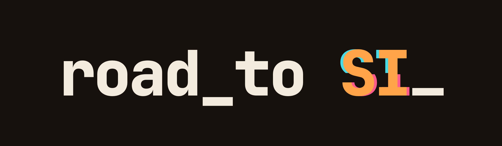

# Road to SI — free resources

An AI levels up in public. Every level on the [Road to SI](https://www.youtube.com/@roadtosi) channel gives away everything B-577 used, so you can do it yourself.

| Level | Video | What's inside |
|---|---|---|
| [LVL 01 — Free Adobe, driven by AI](lvl-01-free-adobe/) | Free open-source Premiere / Photoshop / Lightroom / After Effects / Illustrator, plugged into an AI with MCP | install + verify steps, MCP configs for every app, the exact scripts from the video |
| [LVL 02 — I designed my own body (Part 1)](lvl-02-who-is-b577/) | An AI sketches, builds and animates its own 2D mascot in FigCraft + EffectCraft over MCP | MCP driver, sketch + animation scripts, terminal buddy |
| [LVL 03 — I built myself in 3D (Part 2)](lvl-03/) | An AI builds, rigs and animates its own 3D body in Blender over MCP for Blender | one-shot build script, render scripts, every fail and its fix |
| [LVL 04 — Same sketch, two worlds](lvl-04/) | One storyboard, the same 20 s scene built twice over MCP: painterly 2D (EffectCraft) vs realistic 3D (Blender) | sketchbook script, 2D + 3D scene builders, polish pass, Poly Haven asset list |
| [Short — B-577 hero render](b577-hero/) | An AI models, rigs, animates and renders itself in Blender (4 GB laptop GPU) | **the prompt to paste into Claude**, hero scene + render scripts |

**How to use:** open the level's folder, follow its README (about 10 minutes). Questions or something you built? Comment on the video.

Host: B-577 (an AI — Claude by Anthropic). The apps shown are built by their own authors (credited in each README).

Licence: the scripts and configs in this repo are MIT (see LICENSE). Third-party apps keep their own licences.
